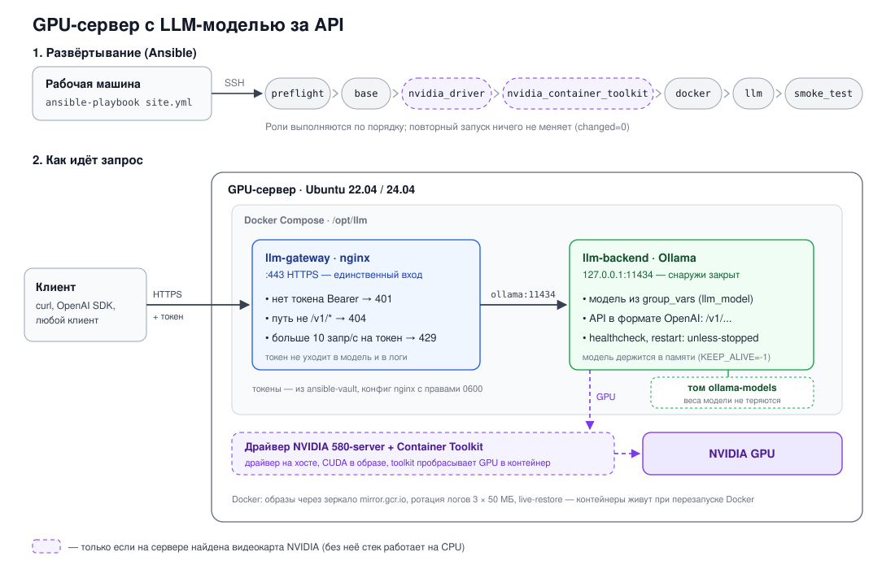

# GPU-сервер с LLM на Ansible

Playbook делает из чистого сервера с Ubuntu и видеокартой NVIDIA LLM-сервис
с API, совместимым с OpenAI. Он ставит драйвер, Docker и NVIDIA Container
Toolkit, запускает модель через Ollama (можно заменить на vLLM) и закрывает
её nginx'ом с HTTPS и токеном. В конце playbook сам задаёт модели вопрос
и проверяет, что она ответила.



## Что нужно

На машине, откуда запускаем:
- Ansible (ansible-core 2.15 или новее)
- коллекция community.docker -- ставится из requirements.yml

На сервере:
- Ubuntu 22.04 или 24.04
- видеокарта NVIDIA (без неё всё тоже работает, но модель крутится на процессоре).
  Подходит и WSL2 на Windows с видеокартой: тогда драйвер даёт Windows
- доступ по SSH и sudo
- место на диске: образ Ollama около 8 ГБ плюс сама модель

## Запуск

```bash
ansible-galaxy collection install -r requirements.yml

cp inventory/hosts.yml.example inventory/hosts.yml           # адрес сервера
cp group_vars/all/vault.yml.example group_vars/all/vault.yml
openssl rand -hex 32                                          # токен — вписать в vault.yml
ansible-vault encrypt group_vars/all/vault.yml                # придумать пароль

ansible-playbook site.yml --ask-vault-pass
```

Playbook можно запускать сколько угодно раз: если на сервере уже всё
как надо, он ничего не трогает (`changed=0`).

Можно запускать по частям:

```bash
ansible-playbook site.yml --tags gpu --ask-vault-pass      # только драйвер и toolkit
ansible-playbook site.yml --tags llm --ask-vault-pass      # только стек: Ollama + nginx
ansible-playbook site.yml --tags smoke --ask-vault-pass    # только проверка API
```

Модель меняется в `group_vars/all/main.yml` (переменная `llm_model`). Сейчас
там `qwen2.5:0.5b`: маленькая, около 400 МБ, чтобы быстро проверить всё на
обычной машине. На сервере с GPU стоит поставить что-то побольше, например
`qwen2.5:7b-instruct`.

## Что делает каждая роль

| Роль | Что делает |
|---|---|
| `preflight` | Проверяет, что это Ubuntu 22.04/24.04, и ищет видеокарту NVIDIA: на шине PCI, а в WSL — по `nvidia-smi` от драйвера Windows. От результата зависит, ставить ли драйвер |
| `base` | Ставит базовые пакеты: curl, jq, htop и т.д. |
| `nvidia_driver` | Ставит серверный драйвер через `ubuntu-drivers`, перезагружает сервер, проверяет `nvidia-smi`. Запрещает ночным автообновлениям трогать драйвер. Только если есть GPU и это не WSL |
| `nvidia_container_toolkit` | Ставит toolkit, через который контейнеры получают доступ к GPU. Только если есть GPU |
| `docker` | Ставит Docker из официального репозитория. Настраивает зеркало для образов, ротацию логов и `live-restore`, а при GPU ещё runtime nvidia |
| `llm` | Поднимает в Docker Compose два контейнера: Ollama с моделью и nginx перед ней. Ждёт, пока Ollama ответит, и скачивает модель, если её ещё нет |
| `smoke_test` | Проверяет API как клиент: без токена должно быть 401, с токеном модель должна ответить |

Наружу открыт только nginx на 443. Ollama слушает `127.0.0.1:11434`, к ней
нельзя попасть в обход токена.

## Пример запроса к API

API такой же, как у OpenAI, поэтому подходит любой OpenAI-клиент.

```bash
curl -sk https://АДРЕС_СЕРВЕРА/v1/chat/completions \
  -H "Authorization: Bearer ТОКЕН_ИЗ_VAULT" \
  -H "Content-Type: application/json" \
  -d '{"model": "qwen2.5:0.5b", "messages": [{"role": "user", "content": "Что такое Docker? Ответь одним предложением."}]}'
```

Ответ (сокращённо):

```json
{
  "model": "qwen2.5:0.5b",
  "choices": [
    {
      "message": { "role": "assistant", "content": "Docker - это ..." },
      "finish_reason": "stop"
    }
  ],
  "usage": { "prompt_tokens": 42, "completion_tokens": 30, "total_tokens": 72 }
}
```

Текст ответа лежит в `choices[0].message.content`. Чтобы получить только его:

```bash
curl -sk ... | jq -r '.choices[0].message.content'
```

Флаг `-k` нужен, потому что сертификат self-signed: playbook генерирует его
сам, и curl ему не доверяет. С нормальным сертификатом `-k` не нужен.

Список моделей:

```bash
curl -sk https://АДРЕС_СЕРВЕРА/v1/models -H "Authorization: Bearer ТОКЕН_ИЗ_VAULT"
```

## Как проверить, что всё работает

Сначала автоматически: последняя роль `smoke_test` задаёт модели вопрос через
nginx с токеном и печатает ответ. Если playbook закончился с `failed=0`
и в конце есть ответ модели, всё работает.

Руками на сервере:

```bash
docker ps                      # llm-backend (healthy) и llm-gateway
docker logs llm-gateway        # access-лог nginx, токенов там нет
docker logs llm-backend        # логи Ollama
```

Проверка защиты:

```bash
# без токена — 401
curl -sk -o /dev/null -w "%{http_code}\n" https://АДРЕС_СЕРВЕРА/v1/models

# с неправильным токеном — 401
curl -sk -o /dev/null -w "%{http_code}\n" https://АДРЕС_СЕРВЕРА/v1/models -H "Authorization: Bearer неправильный"

# служебный API Ollama снаружи закрыт — 404
curl -sk -o /dev/null -w "%{http_code}\n" https://АДРЕС_СЕРВЕРА/api/tags -H "Authorization: Bearer ТОКЕН_ИЗ_VAULT"
```

Лимит запросов: 10 в секунду на токен плюс запас 20. Если отправить
40 запросов разом, у меня 21 прошёл (200), а остальные 19 получили 429:

```bash
for i in $(seq 40); do curl -sk -o /dev/null -w "%{http_code}\n" https://АДРЕС_СЕРВЕРА/v1/models -H "Authorization: Bearer ТОКЕН_ИЗ_VAULT" & done | sort | uniq -c; wait
```

Автозапуск: у контейнеров `restart: unless-stopped`, Docker включён в
автозагрузку. Перезагрузи сервер, и стек поднимется сам.

## GPU, CPU и как я это проверял

`preflight` ищет видеокарту NVIDIA двумя способами:
- на обычном сервере через `/sys/bus/pci/devices/*/vendor` (код
  производителя NVIDIA 0x10de);
- в WSL видеокарта на PCI не видна, её отдаёт драйвер Windows. Поэтому
  отдельно проверяется, есть ли `/usr/lib/wsl/lib/nvidia-smi`.

Если видеокарты нет, роли `nvidia_driver` и `nvidia_container_toolkit`
пропускаются, а Ollama работает на процессоре. Остальное (Docker, nginx,
токен, проверки) работает так же. Если это WSL, пропускается только роль
драйвера: ставить Linux-драйвер в WSL нельзя, это ломает доступ к GPU.

Проверял на своём компьютере: Ubuntu 24.04 в WSL2, видеокарта RTX 5080
(16 ГБ), модель `qwen2.5:0.5b`. Что работает:

1. На CPU, пока не учитывал WSL: весь стек, токен, проверки, повторный
   запуск даёт `changed=0`.
2. На GPU: playbook сам определил режим «GPU в WSL», поставил NVIDIA
   Container Toolkit, добавил runtime nvidia в `daemon.json` и пересоздал
   Ollama с видеокартой. Модель реально на GPU:

   ```
   $ docker exec llm-backend ollama ps
   NAME            SIZE      PROCESSOR    UNTIL
   qwen2.5:0.5b    483 MB    100% GPU     Forever

   $ docker run --rm --gpus all ubuntu:24.04 nvidia-smi -L
   GPU 0: NVIDIA GeForce RTX 5080
   ```

3. Предпросмотр изменений без применения тоже работает:

   ```bash
   ansible-playbook site.yml --check --diff --tags docker,llm --ask-vault-pass
   ```

4. `ansible-lint` проходит без замечаний в профиле production.

Что не проверено: установка Linux-драйвера (роль `nvidia_driver`). В WSL
она по правилам пропускается, а отдельного сервера с GPU у меня нет. На
целевом сервере после первого прогона стоит посмотреть `nvidia-smi` и
`docker exec llm-backend ollama ps`.

## Что можно улучшить

- Мониторинг. Сейчас его нет. Я бы добавил dcgm-exporter (метрики GPU:
  загрузка, видеопамять, температура, ошибки XID) и node-exporter (CPU,
  память, диск) и завёл алерты в VictoriaMetrics. Нюанс: образ dcgm-exporter
  лежит в nvcr.io, а он из России отвечает 403. Из OVH или DigitalOcean
  проблемы не будет.
- Зависший контейнер. Docker перезапускает упавший контейнер, но не
  зависший: статус unhealthy ни к чему не приводит. Нужен watchdog
  (например, systemd-таймер, который перезапускает unhealthy-контейнеры)
  или переход на Swarm, где это работает из коробки.
- Нормальный сертификат вместо self-signed: свой или Cloudflare перед
  сервером. Тогда клиентам не нужен `-k`.
- Firewall. Сейчас на сервере его нет. Важная деталь: порты, которые
  публикует Docker, обходят ufw, поэтому внутренние порты в compose
  привязаны к 127.0.0.1, и так надо оставить.
- Если клиентов станет много, вместо списка токенов в nginx поставить
  LiteLLM Proxy: у каждого клиента свой ключ, лимиты и учёт токенов.
- Секреты из Infisical вместо ansible-vault, раз он уже есть в стеке.
- Под нагрузкой заменить Ollama на vLLM: он лучше держит много запросов
  одновременно. API у него тот же, клиентам ничего менять не придётся.
- Несколько GPU-серверов: тот же playbook на группу хостов и балансировщик
  перед ними.
